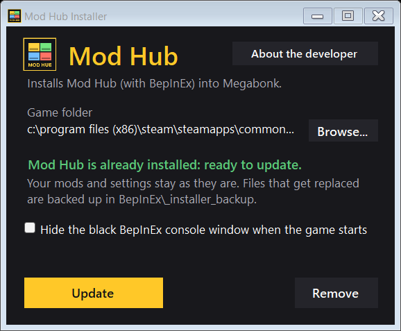
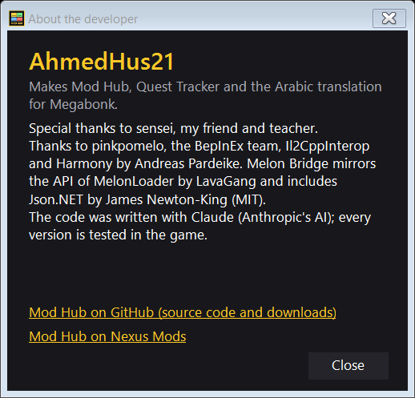

# Mod Hub — source

An in-game mod manager for **Megabonk** (BepInEx 6, IL2CPP). Press **F4** in game to open it.
Players download it from the [Nexus page](https://www.nexusmods.com/megabonk/mods/194); the zips are attached to the
[releases](../../releases) of this repo — Mod Hub updates itself from there, because Nexus allows no direct downloads.

## Installer

The easiest way to install: **Mod Hub Installer** (`Mod.Hub.Installer.<version>.exe` in the [releases](../../releases)).
It finds Megabonk through Steam, installs Mod Hub with BepInEx, checks every file, then starts the game and tells you
when Mod Hub has loaded. It can also remove Mod Hub (or Mod Hub and BepInEx; nothing is deleted, it goes to a backup
folder) and hide BepInEx's black console window. English and Arabic.




## Layout

```
src/                    the plugin (C#, net6.0) — this is the program
ModHub.csproj           project file; the version number lives here
Installer/              source of the standalone "Mod Hub Installer.exe"
docs/                   screenshots used in this readme
package/                README / INSTALL texts copied into the release zips
build.ps1               builds the plugin and makes the release zips in .\dist
build-thunderstore.ps1  same for the Thunderstore edition (no Nexus code)
thunderstore/           the Thunderstore edition's readme/changelog
```

## Build

Needs the **.NET 6 SDK or newer**, and Megabonk with **BepInEx 6 (IL2CPP)** started at least once (the project
references the game's BepInEx files).

```
powershell -ExecutionPolicy Bypass -File .\build.ps1             # build + zips in .\dist
powershell -ExecutionPolicy Bypass -File .\build.ps1 -Install    # also copy it into your game (close the game first)
```

The script asks Steam where Megabonk is installed, on any drive or library. If BepInEx isn't in the game folder
(r2modman / Gale keep it in a profile), pass that folder: `-GameDir "C:\path\to\profile"` (the All-in-One zip is
then skipped). It also builds **Melon Bridge** when the `MelonBridge` project sits next to this folder; without it
the zips (and the installer) are named `-noMelonBridge` and must not be published.

`dist\Mod Hub Installer <version>.exe` holds the All-in-One zip: it finds the game through Steam, installs, checks
every file, then starts the game and waits until Mod Hub says it loaded. Test it on fake game folders (never the real
game) with `powershell -ExecutionPolicy Bypass -File .\Installer\test-installer.ps1 "dist\Mod Hub Installer <version>.exe"`.

## Rules for changes

- Every player-facing string goes through `L.T(english, arabic)`. Both languages, always.
- Never delete a player's files: removed mods and old versions go to `BepInEx\_hub_removed`.
- No release without the author's OK. A release = the two zips, on GitHub **and** Nexus.
- Offline must not break the Hub (no Thunderstore/Nexus = installed list still works, no crash).
- Credits stay in the readme and on the Nexus page: special thanks to **sensei**, then pinkpomelo, BepInEx team,
  Il2CppInterop, Harmony (pardeike); Melon Bridge: MelonLoader API by LavaGang, Json.NET by James Newton-King.

## Todo

The task list for future work is in [TODO.md](TODO.md).
